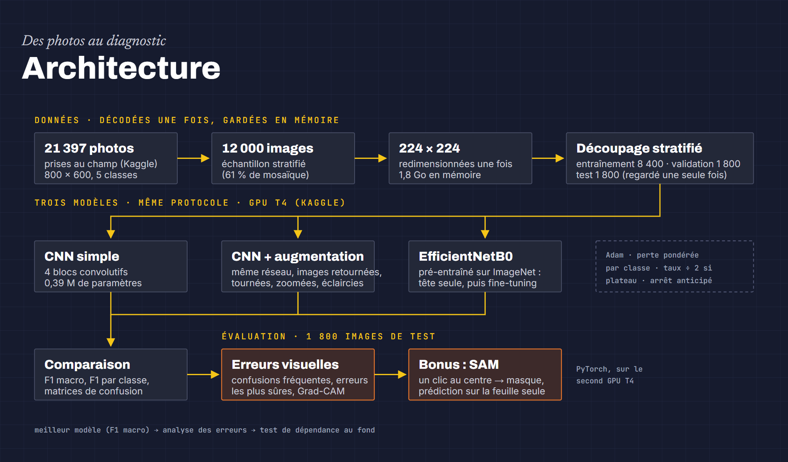

# Foliole — diagnostic des maladies du manioc

Travail pratique image du cours **INF5101 — Traitement multimédia des données** (Master 2,
ENSPY) :

> Construire une petite classification d'images avec transfer learning. Comparer CNN simple,
> modèle pré-entraîné et augmentation de données. Afficher la matrice de confusion et analyser
> les erreurs visuelles. Bonus : tester une segmentation avec U-Net ou SAM.

Le manioc nourrit plus de 800 millions de personnes et ses principales maladies se lisent sur
les feuilles. On classe des photos prises **au champ, avec des téléphones**, en cinq classes :
bactériose (CBB), striure brune (CBSD), marbrure verte (CGM), mosaïque (CMD) et feuille saine.

- **Notebook** : [`notebooks/classification_manioc.ipynb`](notebooks/classification_manioc.ipynb),
  exécuté sur Kaggle (GPU T4), avec toutes ses sorties.
- **Application** : [`app/`](app/), un diagnostic à partir d'une photo, avec le modèle exécuté
  dans le navigateur (ONNX Runtime Web).
- **Aide-mémoire** : [`docs/aide-memoire.md`](docs/aide-memoire.md), les notions et chaque
  ligne du notebook expliquées.



## Résultats

12 000 photos tirées des 21 397 du jeu *Cassava Leaf Disease Classification* (Makerere AI
Lab), découpage stratifié 8 400 / 1 800 / 1 800. Scores sur les 1 800 photos de test :

| Modèle | Paramètres | Exactitude | F1 macro |
|---|---|---|---|
| CNN simple | 0,39 M | **0,770** | 0,635 |
| CNN + augmentation | 0,39 M | 0,643 | 0,540 |
| EfficientNetB0 (transfert) | 4,1 M | 0,745 | **0,640** |

- **Le transfert vaut surtout quand les données manquent** : à 4 200 images d'entraînement, il
  menait de 7 points de F1 macro (0,620 contre 0,547) ; à 8 400, l'écart disparaît.
- **L'augmentation soigne le surapprentissage, pas le sous-apprentissage** : le petit CNN
  sous-apprend déjà, l'augmentation le dégrade.
- **Erreurs** : mosaïque prise pour marbrure verte (116 cas), feuilles malades prises pour
  saines, et des erreurs « sûres à 100 % » qui ressemblent à des erreurs d'étiquette. Grad-CAM
  montre que le réseau regarde les feuilles, pas le sol.
- **SAM** : un clic au centre ne détoure souvent qu'une foliole (9 % de l'image) ; sur cette
  seule partie, le F1 tombe de 0,70 à 0,19.

## Et si ce n'est pas du manioc ?

Un classifieur à cinq classes répond toujours l'une d'elles, même devant une capture d'écran.
L'application refuse donc d'abord les images trop éloignées du manioc : distance de Mahalanobis
minimale entre les 1 280 caractéristiques de l'image et les centres des classes (covariance
commune Ledoit-Wolf), seuil réglé pour accepter 95 % du manioc de validation. Le calcul est
greffé dans le graphe ONNX par [`kaggle/ood/ood_detector.py`](kaggle/ood/ood_detector.py).

| Images (500 par famille) | Refusées | AUROC distance | AUROC confiance softmax |
|---|---|---|---|
| Autres plantes (PlantVillage) | 94 % | 0,985 | 0,689 |
| Images courantes (ImageNet) | 97 % | 0,990 | 0,765 |
| Captures d'écran synthétiques | 100 % | 1,000 | 0,954 |

Le manioc de test est accepté à 95,3 %. La confiance softmax, elle, sépare mal le manioc des
autres plantes.

## Reproduire

Le notebook s'exécute sur Kaggle, où les données sont hébergées (les règles de la compétition
interdisent de les redistribuer). Avec le CLI Kaggle et la compétition acceptée :

```bash
cd kaggle
python make_runner.py               # embarque le notebook dans un script exécuté par nbconvert
kaggle kernels push -p .            # lance l'exécution sur GPU (environ 1 h 15)
kaggle kernels output <utilisateur>/tp2-classification-manioc -p sortie
```

Le modèle de l'application est réentraîné et exporté par
[`kaggle/export/train_export.py`](kaggle/export/train_export.py) (SavedModel puis tf2onnx) :
F1 macro de 0,633 sur le test en float32 (16 Mo). La version quantifiée en int8 (4,5 Mo)
tombait à 0,605, on garde donc float32.

## Application

```bash
cd app
pnpm install
pnpm dev
```

Site statique (Vite, React, Tailwind) : le modèle ONNX est servi depuis `public/models/` et
exécuté en WebAssembly. Aucune photo ne quitte l'appareil.

## Auteur

Luciano Fokouo Saadie — [portfolio](https://portofolio-luciano-rho.vercel.app/).
